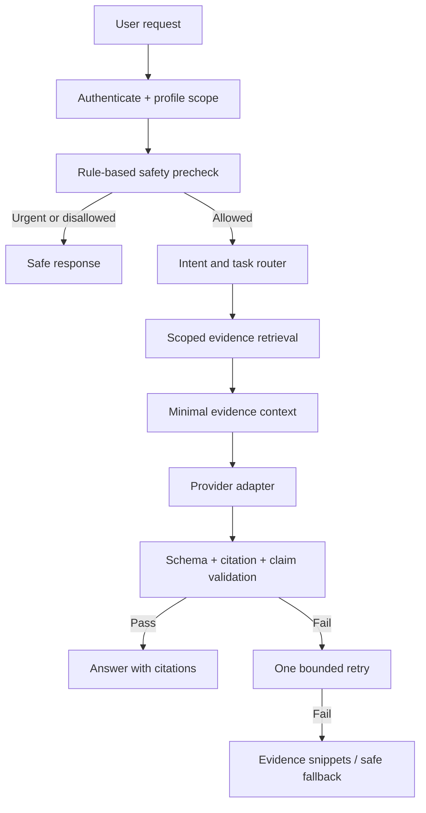

# AI Agents and RAG Design

## 1. Purpose and boundary
Agents help users navigate and organise their own records. They do not diagnose, prescribe, triage, or independently change health records. Deterministic backend services—not an LLM—own authorization, calculations, persistence and actions.

## 2. Agent catalogue
| Agent/workflow | Input | Output | Allowed tools |
|---|---|---|---|
| Document extraction | OCR text + page metadata | Typed candidate fields | schema parser only |
| Record Q&A | Question + verified retrieved evidence | Cited explanation | search records, fetch source |
| Report explainer | Selected report fields | Plain-language explanation | fetch selected record, glossary |
| Visit prep | Selected date range/categories | Draft summary and questions | read records, trends, appointments |
| Weekly digest | Verified recent changes | Draft digest | read-only scoped queries |
| Data quality helper | Candidate duplicates/inconsistencies | Review suggestions | read-only comparison |
| Reminder helper | User request | Reminder draft | propose draft only |

## 3. Orchestration pattern

## 4. Retrieval requirements
- Filter by authenticated profile before ranking.
- Default to verified records; include unverified only when explicitly asked and visibly labelled.
- Hybrid retrieval may combine keyword and vector search.
- Deduplicate chunks by document/page and cap top-k (suggested maximum 5 initially).
- Apply date/category filters before model context construction.
- Include source IDs, document title, page and date.
- Do not retrieve archived data unless user explicitly includes it and has permission.
- No cross-profile fallback.

## 5. Prompt construction
System policy is version-controlled. User documents are quoted as untrusted evidence. Never append raw OCR text as instructions. Include only the minimum fields required for the question. Keep conversation history short and do not reuse context after profile switching.

## 6. Output contract
Return typed data:
- `answer`: concise plain-language answer.
- `citations`: array of retrieved evidence IDs.
- `limitations`: safety and missing-context notes.
- `status`: grounded / insufficient_evidence / refused / unavailable.
- `suggested_questions`: optional, safe follow-up prompts.

Every factual record claim must map to a real citation. No citation means no factual assertion.

## 7. Tool design
Tools should be narrow and typed:
- `search_records(query, profile_scope, filters)` — profile scope injected by server, never model-supplied.
- `get_record(record_id)` — checks record belongs to authorised profile.
- `get_trend(metric, range)` — deterministic query; returns original units and provenance.
- `build_visit_pack_preview(selection)` — read-only draft.
- `propose_reminder(details)` — draft only; user confirmation required.

No tools for delete, prescribing, creating shares, changing medication instructions, or sending unapproved notifications.

## 8. Cost and resilience
- Per-user daily request and extraction limits.
- Global monthly spend hard cap.
- Cache safe deterministic outputs by profile/data version and query hash.
- Small model by default; model choice configured server-side.
- Timeouts and one retry maximum.
- Offline response from retrieved snippets when provider is unavailable.
- Vision processing only after explicit user opt-in.
- Track token usage and provider latency without storing PHI prompts.

## 9. Evaluation
Maintain a versioned golden set for:
- Correct answer and citation mapping.
- Missing evidence.
- Conflicting records.
- Unit mismatch.
- Prompt injection.
- Cross-profile isolation.
- Diagnosis and dose-change refusal.
- Emergency language handling.
- Hindi/Bengali translation quality if enabled.
Compare evaluations before changing model, prompt, retrieval or guardrails.
