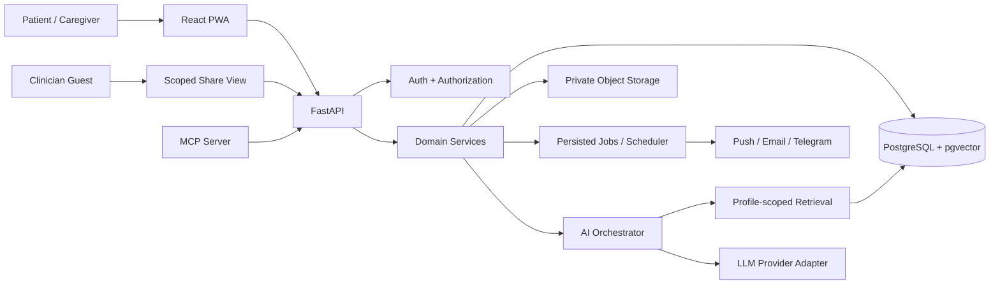

# System Architecture

## 1. Architecture goals
- Preserve strict user/profile isolation.
- Separate deterministic business logic from model reasoning.
- Make AI optional and provider-independent.
- Keep originals and verified structured facts traceable.
- Support asynchronous document processing and reminder delivery.
- Make every sensitive action auditable.

## 2. Logical system context



## 3. Technology boundaries
### Frontend
React + TypeScript + Vite. Owns presentation, local form state, accessibility and API calls. It is never the authority for access control, profile scope or clinical verification.

### Backend
FastAPI routes validate requests and delegate to domain services. Services enforce authorization, transaction boundaries and business rules. Repositories encapsulate database access.

### Data
PostgreSQL is the source of truth for users, profiles, structured records, consent, shares, reminders and audit events. pgvector is optional for semantic retrieval. Object storage holds originals and generated exports.

### AI
AI Orchestrator selects a workflow, retrieves authorised evidence, invokes a provider adapter, validates schema/citations/safety and returns a typed result. Models cannot choose user_id/profile_id or invoke privileged actions directly.

### Background processing
Persisted job records support OCR, extraction, notifications, cleanup and scheduled tasks. Jobs are idempotent, retry-bounded and observable.

## 4. Backend module layout (reference)
```text
backend/app/
  main.py
  core/          config, security, logging, rate_limits
  api/v1/        routers
  models/        SQLAlchemy models
  schemas/       Pydantic request/response models
  repositories/  scoped database access
  services/      domain logic
  agents/        workflows, prompts, retrieval, validators
  integrations/  llm, ocr, storage, email, push, telegram
  jobs/          document and reminder workers
  middleware/    request_id, security_headers
  tests/
```

## 5. Frontend module layout (reference)
```text
frontend/src/
  app/           router, providers, query client
  components/    shared accessible UI
  features/
    auth/
    profiles/
    dashboard/
    documents/
    timeline/
    medications/
    appointments/
    visit-pack/
    assistant/
    sharing/
    settings/
  services/      typed API client
  hooks/
  schemas/
  styles/
```

## 6. Core data flows
### Upload to verified record
1. User uploads file with active profile context.
2. Backend derives authorised profile from session and checks role.
3. File is validated and stored privately; checksum recorded.
4. Job is queued with status `uploaded`.
5. OCR extracts page text and metadata.
6. Extraction agent returns schema-constrained candidates.
7. Backend stores candidates as unverified.
8. User reviews source and fields; accepted values become verified in a transaction.
9. Timeline/search indexes are updated.
10. Audit event records reviewer and changes.

### Ask a health-record question
1. Authenticate request and resolve active authorised profile.
2. Run emergency-intent pre-check.
3. Classify allowed task; reject diagnosis/prescribing.
4. Retrieve verified chunks filtered by profile and access scope.
5. Build minimal prompt; mark retrieved content as untrusted evidence.
6. Invoke model within quota and timeout.
7. Validate output schema, claims and citation IDs.
8. Reject/regenerate once if invalid; then return safe evidence snippets.
9. Store redacted operational metrics, not raw PHI prompts.

### Reminder delivery
1. User confirms schedule and channels.
2. Scheduler finds due reminder using row locks / idempotency key.
3. Create notification attempt record.
4. Send discreet notification.
5. Persist provider result and delivery state.
6. Dose action validates ownership and one-time action token.
7. Escalation only occurs when explicitly configured and consented.

### QR share
1. Owner chooses profile, categories, date range, expiry and PIN option.
2. Server creates high-entropy random token; stores only token hash.
3. QR encodes opaque share URL.
4. Guest verifies PIN / rate limit and receives read-only scoped projection.
5. Every access is logged.
6. Revoke/expiry invalidates token immediately.

## 7. Authorization invariant
Every query involving health data must include an authorised profile scope derived from the authenticated principal and permission service. Never trust `profile_id`, role, owner ID or access scope supplied only by a client or model.

## 8. Reliability and failure handling
- AI provider unavailable: return retrieved evidence and explain AI is unavailable.
- OCR unavailable: preserve upload and offer manual entry.
- Object storage unavailable: fail upload safely; do not create a broken public URL.
- Notification provider unavailable: retry with bounded backoff and alternate opted-in channel.
- Database unavailable: fail closed for private data; never serve stale cross-profile cache.
- Job retries: maximum attempts, dead-letter/failed state and operator visibility.

## 9. Deployment topology
- Static frontend on Vercel or equivalent.
- FastAPI service on Render or equivalent.
- Managed PostgreSQL with TLS and backups.
- Private object storage.
- Scheduled trigger for due jobs where a dedicated worker is not available.
- External uptime monitoring with no PHI.
Free-tier sleep, quotas and storage limits must be reflected in product messaging.

## 10. Architecture constraints
- No direct DB access from frontend.
- No LLM-generated SQL.
- No model-controlled profile IDs.
- No public object bucket for health documents.
- No unbounded agent loops or unrestricted tools.
- No background job without idempotency and failure state.

## Quick Reference AI flow (v4)

Quick Reference is a thin experience over existing domain services, not a second independent agent platform. Route deterministic term/reference searches and record lookups first. Invoke the OpenAI adapter only for bounded explanation or rewriting after retrieval. Validate the response before returning it. When OpenAI is disabled or unavailable, return retrieval-only results or a clear fallback. Keep profile authorization, citations, quotas, cache-key construction and safety validation in backend services—not in prompts alone. See `QUICK_REFERENCE_AI.md`.
