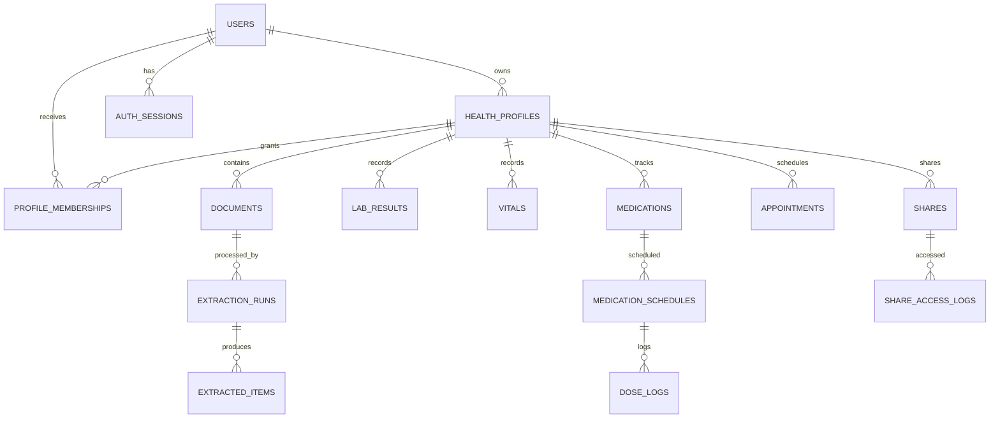

# Database Design

## 1. Conventions
- PostgreSQL; UUID primary keys unless an existing migration uses another stable convention.
- UTC timestamps in storage; retain user timezone (IANA name) for schedules and display.
- `created_at`, `updated_at` on mutable entities.
- Foreign keys with deliberate delete behavior; avoid cascading deletion across audit records.
- Store source provenance and verification status on every extracted clinical fact.
- Use SQLAlchemy models and Alembic migrations; never edit production schema manually without a reviewed migration.

## 2. Core entity catalogue
| Entity | Purpose | Important relationships |
|---|---|---|
| users | Account identity | owns profiles, sessions |
| auth_sessions | Refresh/session lifecycle | belongs to user |
| health_profiles | Person whose records are managed | belongs to owner user |
| profile_memberships | Caregiver/guest permissions | user ↔ profile |
| consent_records | Purpose-specific consent history | user/profile |
| documents | Original uploaded files and processing state | profile, uploader |
| document_pages | OCR text/page metadata | document |
| extraction_runs | Model/OCR execution metadata | document |
| extracted_items | Candidate structured facts | extraction run |
| lab_results | Verified/unverified lab observations | profile, document |
| vitals | BP, pulse, weight and other measurements | profile, source |
| medications | Medication record as documented | profile, source |
| medication_schedules | User-confirmed reminder schedule | medication |
| dose_logs | Taken/skipped/snoozed/unknown events | schedule |
| appointments | Visit details | profile |
| symptoms | User-entered symptom diary | profile |
| embeddings/chunks | Searchable source segments | profile, document |
| shares | Scoped, expiring guest access | profile, creator |
| share_access_logs | Guest access audit | share |
| reminders | Scheduled notification jobs | profile |
| notification_attempts | Channel delivery attempts | reminder |
| push_subscriptions | Web Push endpoint and keys | user |
| ai_usage | Quota accounting | user |
| audit_logs | Sensitive action history | actor/profile |
| duplicate_candidates | Reviewable duplicate relationships | records/documents |

## 3. Suggested fields
### users
`id`, `email_normalized` unique, `password_hash`, `is_active`, `email_verified_at`, `created_at`, `updated_at`.

### health_profiles
`id`, `owner_user_id`, `display_name`, `relationship_label`, `date_of_birth` nullable, `sex_at_birth` nullable only if product use case justifies it, `timezone`, `created_at`, `updated_at`, `archived_at`.

Avoid collecting demographic fields without a documented purpose. Restrict especially sensitive attributes.

### profile_memberships
`id`, `profile_id`, `user_id`, `role`, `permissions_json`, `invited_by`, `accepted_at`, `revoked_at`, unique active membership constraint.

### documents
`id`, `profile_id`, `uploaded_by`, `storage_key`, `original_filename`, `mime_type`, `size_bytes`, `sha256`, `page_count`, `status`, `is_archived`, `uploaded_at`, `processed_at`, `failure_code`.

Do not store public object URLs. `storage_key` is an internal locator.

### extracted_items
`id`, `document_id`, `profile_id`, `item_type`, `candidate_json`, `confidence`, `page_number`, `bounding_box_json`, `verification_status`, `reviewed_by`, `reviewed_at`, `rejection_reason`.

### lab_results
`id`, `profile_id`, `document_id`, `extracted_item_id`, `test_name_original`, `test_name_normalized`, `value_numeric`, `value_text`, `unit_original`, `unit_normalized`, `reference_low`, `reference_high`, `reference_text`, `collected_at`, `lab_name`, `verification_status`, `created_by`.

Do not force qualitative results into numeric columns. Keep original and canonical values separately.

### vitals
`id`, `profile_id`, `vital_type`, `value_numeric`, `secondary_value_numeric`, `unit`, `context`, `measured_at`, `verification_status`, `source_document_id`, `created_by`.

For blood pressure, store systolic and diastolic separately with one measurement event.

### medications
`id`, `profile_id`, `name_as_written`, `ingredient_normalized` nullable, `strength_as_written`, `form`, `instructions_as_written`, `start_date`, `end_date`, `status`, `verification_status`, `source_document_id`, `created_by`.

The system stores what the source/user says; it does not infer or recommend treatment.

### shares
`id`, `profile_id`, `created_by`, `token_hash`, `scope_json`, `date_from`, `date_to`, `expires_at`, `pin_hash` nullable, `revoked_at`, `last_accessed_at`, `created_at`.

Never store the raw share token or put it in logs.

## 4. Relationships

## 5. Indexes and constraints
- `users(email_normalized)` unique.
- `health_profiles(owner_user_id, archived_at)`.
- `profile_memberships(profile_id, user_id, revoked_at)`.
- All profile-scoped tables: `(profile_id, created_at)` or query-specific date indexes.
- `documents(profile_id, sha256)` for duplicate detection.
- `lab_results(profile_id, test_name_normalized, collected_at DESC)`.
- `vitals(profile_id, vital_type, measured_at DESC)`.
- `reminders(status, fire_at)` partial index for queued jobs.
- `shares(token_hash)` unique; `shares(expires_at, revoked_at)`.
- `audit_logs(profile_id, created_at DESC)` and actor/time indexes.
- pgvector index only after choosing embedding dimensions and measuring query plan.

## 6. Row-level security
Application-level permission checks are mandatory. PostgreSQL RLS may provide defence in depth if the connection strategy safely sets a transaction-local user/profile context. Never rely on a session variable that can leak through pooled connections.

## 7. Data lifecycle
- Upload: private object + metadata.
- Processing: OCR text and extraction candidates.
- Verification: user-confirmed structured facts.
- Archive: excluded from default queries, retained until deletion policy says otherwise.
- Delete: documented retention workflow; remove objects, derived chunks and embeddings, while retaining only legally/operationally required minimal audit metadata.
- Export: generate short-lived private object; expire automatically.

## 8. Migrations
1. Generate migration from model changes.
2. Inspect generated SQL manually.
3. Test from empty database and previous migration head.
4. Verify indexes and constraints.
5. Back up before production migration.
6. Deploy migration in controlled step; confirm `alembic current == alembic heads`.
7. Never rewrite an already-applied migration.

## 9. v3 additions (entities missing from v2)
| Entity | Key fields | Notes |
|---|---|---|
| allergies | profile_id, substance, reaction, severity, verification_status, updated_at | Needed by Visit Pack and Emergency Card |
| conditions | profile_id, name, since, notes, verification_status | User-entered only |
| invitations | profile_id, email, role, token_hash, expires_at, accepted_at, revoked_at | For caregiver flow |
| emergency_cards | profile_id, enabled, fields_json, token_hash, rotated_at | Separate token from normal shares |
| mcp_tokens | user_id, token_hash, scopes, profile_ids, expires_at, revoked_at, last_used_at | Hash only |
| jobs | type, payload_json, status, attempts, run_after, locked_at, last_error | Persisted jobs (ARCHITECTURE requires it); index (status, run_after) |
| tick_runs | started_at, finished_at, sent_count, failed_count | Cron monitoring |
| notification_preferences | user_id, push_enabled, telegram_enabled, email_enabled, discreet_mode, quiet_hours, escalation_after_minutes, caregiver_user_id | |
| telegram_links / telegram_link_codes | user_id, chat_id UNIQUE, default_profile_id, intake_enabled / code_hash, expires_at, used_at, attempts | |
| visit_notes | profile_id, appointment_id, advice_text, tests_recommended, follow_up_on, questions_open | Doctor visit memory |
| record_links | profile_id, from_type, from_id, to_type, to_id, relation, created_by | Simple relational "memory graph", no graph DB |
| medication_conflicts | profile_id, medication_ids[], detected_reason, status (open/resolved/dismissed), resolved_by, resolution_note | History preserved |
| followup_items | profile_id, source_document_id, text, due_hint, status (open/done/dismissed), confirmed_by | Missing-link finder |
| family_tasks | profile_id, title, assignee_user_id, due_at, status | P2 |
| ai_cache | key_hash UNIQUE, profile_id, data_version, response_json, created_at | Safe cache keyed by profile data version |
Also: `reminders` needs `dedupe_key` UNIQUE, `channel_chain`, `escalate_at`; `documents` needs `source` (web/telegram) and `ocr_confidence`; `ai_usage` should be unique per (user_id, day, kind).

## Quick Reference AI data notes (v4)

Reuse the existing `ai_cache`, `ai_usage`, document chunks/embeddings and knowledge-search structures where they meet the requirements. Do not create duplicate cache or usage tables without a migration review.

If the current schema cannot represent curated reference sources, add a migration-reviewed catalogue with at least: `id`, `title`, `publisher`, `canonical_url`, `license_or_reuse_note`, `published_at`, `retrieved_at`, `content_version`, `is_active`, and optional permitted excerpt/chunk metadata. Keep source content rights and provenance explicit. Reference catalogue rows are not user medical records and must not be mixed into profile-scoped record tables.

Personalised AI cache entries must be scoped by user/profile, permission/data version, archive filter and selected record IDs; use a keyed request hash rather than raw PHI in keys. General-reference cache keys must include source-catalogue and prompt/model versions. Define TTL and invalidation. Never allow a cache hit to bypass current authorization.
